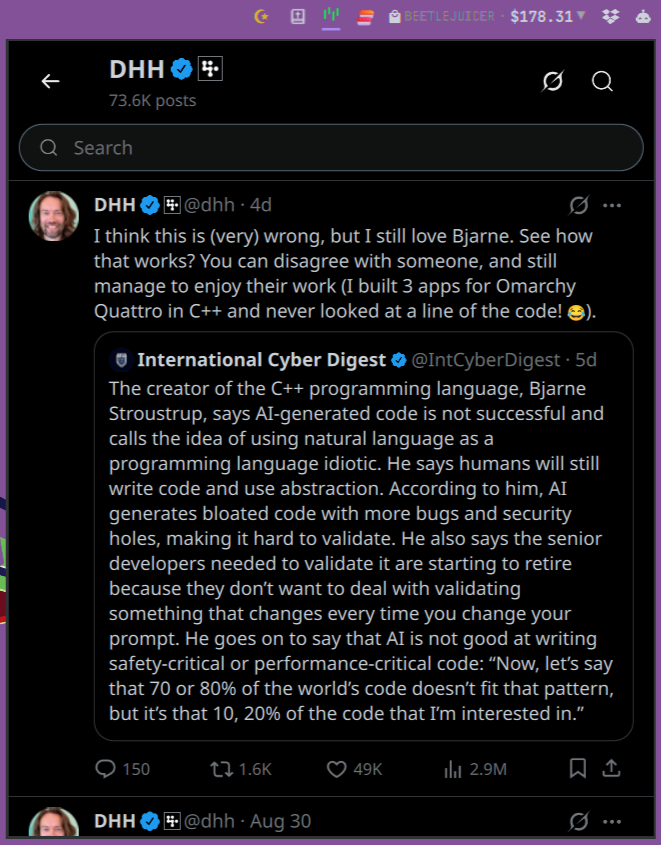

# DHH for Omarchy

An [Omarchy](https://omarchy.org) (Quickshell) bar-widget plugin that searches
David Heinemeier Hansson's (@dhh) public quotes and X posts from a bundled
dataset. A glyph sits in the bar; left-clicking it toggles an x.com-style
profile panel where you can:



- **Browse the feed**: the posts you have copied or rendered, then an endless
  stream of random posts.
- **Search** the dataset as you type, with recent searches and word
  suggestions. Results are ranked: the phrase in order first, then posts with
  every word; plurals and -ing/-ed forms match too, and a typo is corrected
  ("Showing results for …"). A query that matches nothing shows random posts
  under a "No results" line, as x.com does.
- **Copy the text** of a quote or X post to the clipboard.
- **Render an image** of the quote or X post, drawn by the panel itself in a
  frame or two, saved to `~/Pictures/dhh/` and copied to the clipboard.

## Install

```sh
omarchy plugin add https://github.com/ronald2wing/Omarchy-DHH --enable
```

## Usage

- **Click** a post to copy its text, followed by the attribution line and the
  source URL. For `link` entries the copy is the title/domain/URL block, then
  the commentary, then the attribution.
- Click the **share arrow** (or the Grok mark in a post's header) to render
  the post as a PNG at `~/Pictures/dhh/<slug>-<id>.png` and copy it to the
  clipboard. The result shows as a full-width **preview** under the search
  field, with a folder button that opens the output directory. X posts render
  as x.com posts; standalone quotes and links as a quotation image beside a
  grayscale portrait.
- Click the **Grok mark in the header** to render a random post.
- Click the **"..."** on a post to open its source in the browser.
- The engagement counts are decorative, but two act as shortcuts: **Reply**
  opens the post's source (where a reply would be written) and **Repost**
  renders the post.
- Focusing the empty search field opens the **recent searches** dropdown;
  typing opens **word suggestions** with the dataset's **Trending** terms
  first.
- `↑`/`↓` move the result selection, in the search field too. In the field
  `Esc` leaves it; outside it `Enter` copies the selected post, `Esc` closes
  the panel and `Tab`/`Shift+Tab` switch to the neighbouring bar panel.
- Scrolling collapses the header into x.com's compact bar with a **Following**
  pill; clicking the bar scrolls back to the top.

IPC: `qs -c omarchy ipc call dhh toggle` (also `open`, `close`, `show`,
`hide`).

## Layout

| Path | Role |
| --- | --- |
| `BarWidget.qml` | Bar glyph and panel host (the manifest's entry point); creates the model objects |
| `manifest.json` | Plugin manifest: id, version, entry point and the bar widget's listing |
| `model/` | Non-visual QML, and every side effect. `Dataset` (the dataset, searched in `js/dataset-worker.mjs`), `History` and `RecentSearches` (each a `PersistedList` state file), `PostCount`, `AvatarCache`, `ImageFolder` (`~/Pictures/dhh`, made on the first render), `HelperProcess` (runs a helper under a deadline and a byte cap) and the `Desktop` singleton (browser, file manager, clipboard); `qmldir` lists them |
| `ui/base/` | `Look` (x.com's palette, type scale, measured geometry and asset URLs) and the primitives: `XText`, `SecondaryText`, `Divider`, `Icon`, `Avatar`, `VerifiedBadge`, `DiscButton`, `PillButton`; `qmldir` lists them |
| `ui/post/` | `TimelinePost` (x.com's timeline post, drawn once for the panel and the saved image) and its parts `AuthorLine`, `PostBody` and `EngagementCount`; the panel's `PostCard` row and `PostList` |
| `ui/render/` | `ImageRenderer` and the two images it saves: `PostImage` (a `TimelinePost` on x.com's black) and `QuotationImage` (a quote beside DHH's portrait) |
| `ui/panel/` | `PanelBody`; the feed's and the results' state (`FeedState`, `ResultsState`) and the `RowLander` that lands their rows; `ProfileHeader`, `ResultsStatusLine`, `UnfollowDialog`, `RenderPreview` |
| `ui/search/` | `SearchField` and its dropdowns: `RecentSearchesDropdown` and `SuggestionsDropdown`, built from `DropdownFrame` and `DropdownRow` |
| `js/` | ES modules shared by the QML, the dataset worker and node: `words`, `search`, `dataset-worker`, `search-status`, `highlight`, `entries`, `rendered-image`, `format`, `line-layout`, `chirp-metrics` (generated) and `os` |
| `lib/` | Ruby library for `helpers/` and `tools/`: `dhh.rb` (the root and the environment scrub) and `dhh/` (`dataset`, `http`, `deadline`, `untrusted_image`, `avatars`, `fxtwitter`, `cli`) |
| `helpers/` | Programs the panel runs: `fetch-avatars`, `fetch-post-count` |
| `tools/` | Maintainer tools: `add-entry`, `import-posts`, `sort-dataset` |
| `dev/` | `measure-chirp.js` (measures Chirp in DevTools on x.com) and `generate-chirp-metrics.mjs` (writes `js/chirp-metrics.mjs` and the line-layout test's check lines from that measurement) |
| `assets/` | `icons/` (x.com glyphs, with `-hover` and colour variants) and `images/` (`dhh-avatar`, `fallback-avatar`, `avatar-mask`, `dhh-portrait`, `affiliate-logo`), each image named after its `Look` token |
| `data/entries.jsonl` | The dataset |
| `tests/` | `run` (every check), `ruby/` (with the shared `test_helper.rb`) and `js/` (with the shared `cases.mjs` runner and the generated `chirp-check-lines.json`) |
| `CONTRIBUTING.md` | Dataset rules, architecture, naming, security invariants and checks |
| `preview.png` | Marketplace preview |

## Data and privacy

- The dataset lives in `data/entries.jsonl` (JSON Lines, one entry per line).
  Its schema, the `type`/`kind`/`context` semantics, the sort invariant, and
  the `tools/` workflows are documented in [CONTRIBUTING.md](CONTRIBUTING.md).
- The plugin writes only two small state files,
  `~/.local/state/dhh/{recent.json,history.json}`: your recent searches and
  the posts you have copied or rendered. Rendered images go to
  `~/Pictures/dhh/`.
- It requests no elevated privileges, runs no background services, and starts
  no second Quickshell process.

## Runtime dependencies

Only programs that ship with default Omarchy. The helpers run on `ruby`. The
panel itself runs `xdg-open` (post sources and the image folder), `mkdir -p`
(the image folder, on the first render) and `wl-copy` through `sh`, which
feeds it the rendered PNG on stdin; wl-copy then stays in the background,
serving the clipboard until something else is copied. Images are drawn and
saved by Qt; text copy uses Quickshell's own clipboard API. No Node.js is
needed at runtime.

## Network access

Two lightweight fetches, each bounded by a Ruby helper and each with an
offline fallback:

- **Context-author avatars** for reply/repost/quote cards, from
  `https://unavatar.io/x/<handle>` via `helpers/fetch-avatars`
  (PNG/GIF/JPEG/WebP by magic bytes only, at most 2048×2048 pixels, 1 MiB
  per avatar, 2 MiB per batch, 8 s per batch, HTTPS-only, PNG bomb chunks
  stripped).
  Cached in memory by `model/AvatarCache.qml`; the bundled fallback avatar is
  shown when a fetch fails. Rendering a reply, repost or quote uses the same
  cache, asking for its context author's avatar first if it is missing.
- **Live post count** from `https://api.fxtwitter.com/2/profile/dhh` via
  `helpers/fetch-post-count` (64 KiB, 5 s), which prints the count as one
  integer, falling back to the default in `model/PostCount.qml`.

Everything else is bundled and works offline.

## Development checks

```sh
tests/run
```

[CONTRIBUTING.md](CONTRIBUTING.md) describes what it runs.

## Remove

```sh
omarchy plugin remove dhh
```

## License

UNLICENSED (all rights reserved); see the `LICENSE` file at the repo root.
The bundled quotes and X posts are public statements by David Heinemeier
Hansson, each linked to its source; the avatar and the portrait are DHH's
public photos. See [CONTRIBUTING.md](CONTRIBUTING.md) for the contribution
rules.
